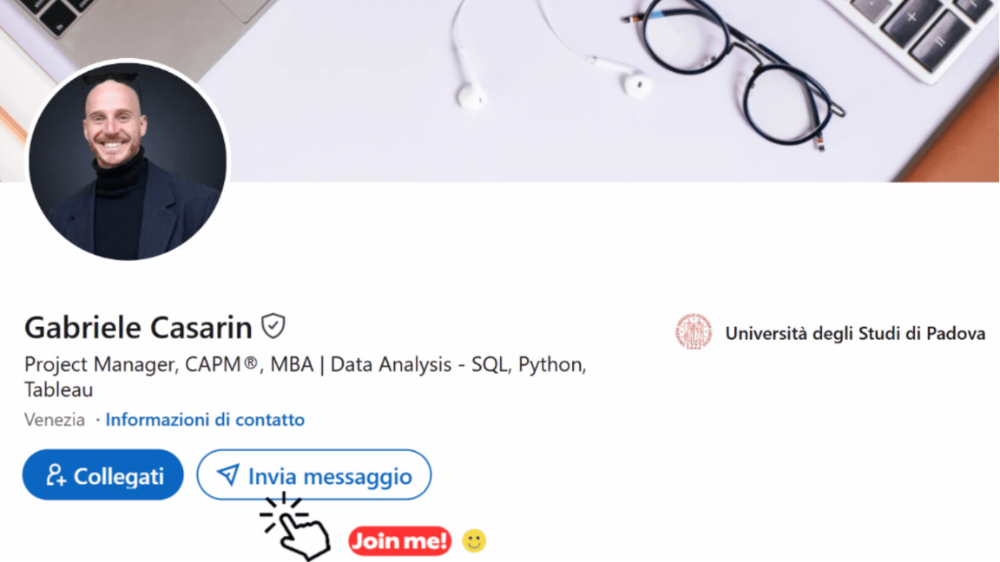

<!-- begin linkedin connect split section -->
<section class="section contact-linkedin-hero">
  

    

      

        

          

            <h2 class="section__title">Let's connect on LinkedIn!</h2>
            

              Join my network on LinkedIn to stay up to date with my recent projects, industry insights, and career milestones. 
              Feel free to send a connection request or start a conversation there to share some good ideas.
            

            <a class="c-button c-button--large c-contact-form__linkedin-btn"
               href="https://www.linkedin.com/in/gabriele-casarin06/"
               target="_blank"
               rel="noopener noreferrer">
              <i class="ion ion-logo-linkedin" aria-hidden="true"></i>
              LinkedIn
            </a>
          

          

            

              
            

          

        

      

    

  

</section>
<!-- end linkedin connect split section -->

<!-- begin contact -->

  

    

      

        

          

            <h2 class="c-contact-form__contact-title">{{ page.form_title | default: site.data.settings.contact_form__settings.form_title }}</h2>
            
{{ site.data.settings.contact_form__settings.form_description }}

          

          <form class="c-contact-form__form"
            action="{{ site.data.settings.contact_form__settings.form_action_url }}"
            method="POST">
            

              <label class="c-contact-form__form-label screen-reader-text" for="form-name">Your Name</label>
              <input class="c-contact-form__form-input" id="form-name" type="text" name="name" placeholder="Your name..." required>
            

            

              <label class="c-contact-form__form-label screen-reader-text" for="form-email">Your Email</label>
              <input class="c-contact-form__form-input" id="form-email" type="email" name="_replyto" placeholder="Your email..."
                required>
            

            

              <label class="c-contact-form__form-label screen-reader-text" for="form-text">Your Message</label>
              <textarea class="c-contact-form__form-input" id="form-text" name="text" rows="9" placeholder="Your message..."
                required></textarea>
            

            

              <button class="c-button c-button--primary c-button--large" type="submit">{{ site.data.settings.contact_form__settings.form_button_text }}</button>
            

          </form>
        

      

    

  

<!-- end contact -->
